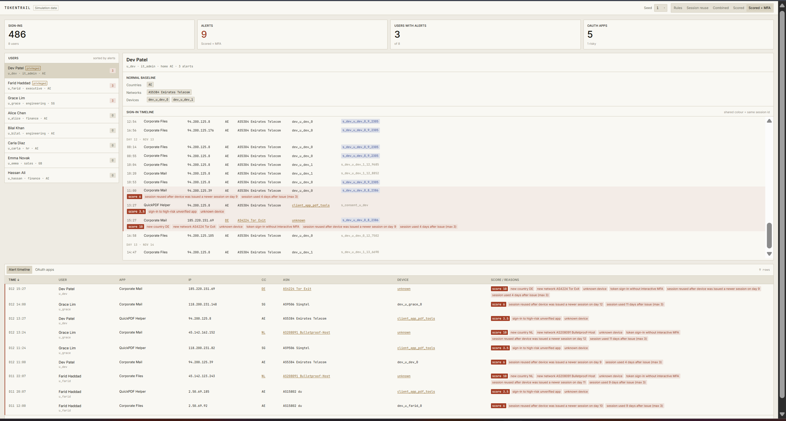

# TokenTrail

**Detecting OAuth consent abuse and stolen session-token replay in SaaS sign-in logs, and measuring which signals actually catch attackers who "log in rather than break in".**

> Simulation only. The tenant, users, sign-ins and attacks are all synthetic. No real accounts or logs are used.



## Why this project exists

Identity has become the main way into organisations. Instead of breaking through a network, attackers steal a valid session token (through infostealer malware or adversary-in-the-middle phishing) or trick a user into granting a malicious OAuth app access to their mail and files. Recent industry reporting describes supply-chain attacks shifting toward stolen OAuth tokens, and threat-intelligence teams describe adversaries who "log in, not break in".

These attacks are hard to detect because they look like legitimate sign-ins: no failed password, often no MFA prompt, sometimes even the victim's own country and ISP.

> Research question: how well can behavioural detection on sign-in logs identify malicious OAuth grants and stolen-token replay, and which signals hold up against a stealthy attacker and realistic user noise?

## What it does

1. **Models a tenant** of 8 users (2 privileged) and 5 OAuth apps, including one unverified app requesting broad mail and file access plus `offline_access`.
2. **Simulates 14 days of sign-ins** modelled on Entra ID / Okta log fields: IP, country, ASN, device, session ID, auth method. Sessions persist for up to 3 days and may change IP mid-session, as real "stay signed in" sessions do.
3. **Injects three attack types** on days 10 to 13:
   - **Illicit consent**: a user grants the malicious app access.
   - **Token replay**: a stolen session reused from Tor or bulletproof hosting with no MFA.
   - **Stealth replay**: a stolen session reused from the victim's own country, ISP and device, during business hours.
4. **Adds realistic innocent noise**: travel, new phones, switching to mobile data, and travelling with a new phone at the same time.
5. **Runs five detectors** and evaluates them across 10 random seeds (90 attacks).
6. **Serves everything through a FastAPI backend** to a React investigation dashboard.

## Results

Evaluated on 10 seeds, 90 attacks (30 per type). Baselines are learned from days 0 to 9 only.

| Detector | Consent | Replay | Stealth | Recall | False positives | Precision |
|---|---|---|---|---|---|---|
| Rules (new country, network, device, risky app) | 30/30 | 30/30 | 0/30 | 66.7% | 51 | 54.1% |
| Superseded or expired session | 0/30 | 29/30 | 29/30 | 64.4% | 0 | 100% |
| Combined, alert on any signal | 30/30 | 30/30 | 29/30 | 98.9% | 51 | 63.6% |
| Risk-scored (strong signals 3, weak signals 1, alert at 3) | 30/30 | 30/30 | 29/30 | 98.9% | 14 | 86.4% |
| Risk-scored + MFA discount | 30/30 | 30/30 | 29/30 | 98.9% | 0 | 100% |

### What the evaluation showed

- **Classic sign-in rules miss every stealth replay.** When an attacker uses the victim's own country, ISP and device, nothing about location or device looks unusual.
- **The strongest signal is session lifecycle.** A legitimate session is only used until its device is issued a newer one. A stolen token is typically replayed after that point. Identity providers apply the same idea when they treat reuse of a rotated refresh token as a sign of theft.
- **A naive version of that signal was useless.** Flagging any session reused on a later day produced 180 false positives (3% precision) once sessions were allowed to last several days. Only "superseded or expired" separated theft from normal use.
- **Several "perfect" results were simulator bugs.** A session-reuse detector scoring 100% was exposed by giving sessions realistic lifetimes. Twenty-one false positives turned out to come from the consent attack wrongly reusing the victim's device ID. Fixing the model, not tuning the detector, removed them.
- **Scoring cuts noise but has limits.** Weighting signals removed the false alarms from single anomalies, but a traveller on a new phone still stacked enough weak signals to alert (14 false positives). Discounting weak signals after fresh interactive MFA removed those without losing a single detection.

## Limitations

Read these before trusting any number above.

- **Synthetic data.** I wrote both the attacks and the detectors. Results show how the signals behave in this environment, not against real tenant logs.
- **The MFA discount has a known blind spot.** Adversary-in-the-middle phishing (Evilginx-style kits) and MFA fatigue both produce sign-ins that look MFA-fresh. Against those, the discount would lower an attacker's score. The 0 false positives for that detector depend on the simulator keeping `auth_method` honest.
- **Fresh token theft is a blind spot.** A token stolen and used before its device is issued a newer session, and within its lifetime, has nothing to supersede. This is the 1 missed stealth replay in 30.
- **Session behaviour is simplified.** A legitimate device in the simulator never returns to an older session. Real browsers occasionally do (multiple tabs, restored backups), which would cause some false positives for the session-lifecycle detector.
- **Hand-chosen weights.** Signal weights and the alert threshold were chosen by reasoning, then checked on seeds 6 to 10, which the weights were not tuned on. Those seeds come from the same simulator, so this is not a test on a different distribution.
- **Small tenant.** 8 users and 14 days per seed. The headline numbers are totals over 10 seeds.

## Run it (Windows, PowerShell)

Backend:

```powershell
cd backend
python -m venv venv
.\venv\Scripts\Activate.ps1
python -m pip install fastapi uvicorn pytest

# generate sign-in data for seeds 1 to 10
1..10 | ForEach-Object { python signins.py $_ }

# reproduce the results
python evaluate_seeds.py 1 2 3 4 5 6 7 8 9 10
python -m pytest

# start the API
python -m uvicorn api:app --reload
```

Frontend, in a second terminal:

```powershell
cd frontend
npm install
npm run dev
```

Then open `http://localhost:5173`. The dashboard needs the API running at `http://127.0.0.1:8000`.

If Windows Application Control blocks `pip.exe` or `uvicorn.exe` inside the venv, run them through Python as shown above (`python -m pip`, `python -m uvicorn`).

## API

| Endpoint | Returns |
|---|---|
| `GET /summary?seed=1&mode=scored_mfa` | Headline counts |
| `GET /apps` | OAuth apps with high-risk scopes and risk flags |
| `GET /users?seed=1&mode=scored_mfa` | Users with alert counts |
| `GET /users/{id}?seed=1&mode=scored_mfa` | Baseline, sign-ins and alerts for one user |
| `GET /alerts?seed=1&mode=scored_mfa` | All alerts, with reasons and scores |

Modes: `rules`, `session_reuse`, `combined`, `scored`, `scored_mfa`. Full shapes are in [`API_SPEC.md`](API_SPEC.md). Simulator ground-truth labels are stripped from every response.

## Dashboard

- **Detection-mode switch**: flip between all five detectors and watch the alerts change. Switching to Rules makes the stealth replays disappear, which is the evaluation in one click.
- **User investigation**: each user's normal baseline, and a sign-in timeline where alerts are highlighted with their reasons and score, out-of-baseline values are underlined, and a session ID used on more than one row is tinted so a replayed token can be followed across the timeline.
- **Alert timeline** and **OAuth apps** tables.

The frontend contains no detection or scoring logic. It only displays what the API returns.

## Tools and AI disclosure

I built this project with AI assistance and want to be clear about how.

- **Backend (Python, FastAPI):** developed step by step with an AI assistant (Claude). I ran every step, reviewed the results, and the design decisions, including what to test, which "perfect" results to distrust, and the simulator bugs to chase down, came out of that process.
- **Design:** the dashboard mock-ups in `design/` were produced in Figma with AI assistance, to my direction on layout and visual style.
- **Frontend (React, TypeScript, Tailwind, TanStack Query):** written by Claude Code against the API spec and the Figma designs, with each step reviewed and approved by me.

## Repository layout

```
backend/
  tenant.json          users, apps and high-risk scopes
  load_tenant.py       tenant loader and app risk rules
  signins.py           seeded sign-in, attack and noise generator
  detector.py          rules, session-lifecycle and risk-scored detectors
  evaluate_seeds.py    multi-seed evaluation table
  test_detector.py     pytest tests
  api.py               FastAPI endpoints
frontend/              React dashboard
design/                Figma mock-ups
API_SPEC.md            response shapes
```

## Possible next steps

- Test against harder noise: corporate VPNs, shared devices, users returning to old browser sessions.
- Model adversary-in-the-middle phishing, where the replayed session carries fresh MFA, and look for signals that survive it.
- Validate on public sign-in datasets instead of only synthetic data.
- Learn signal weights from data instead of choosing them by hand.
- Map detections to MITRE ATT&CK (T1528 *Steal Application Access Token*, T1550.001 *Application Access Token*).
